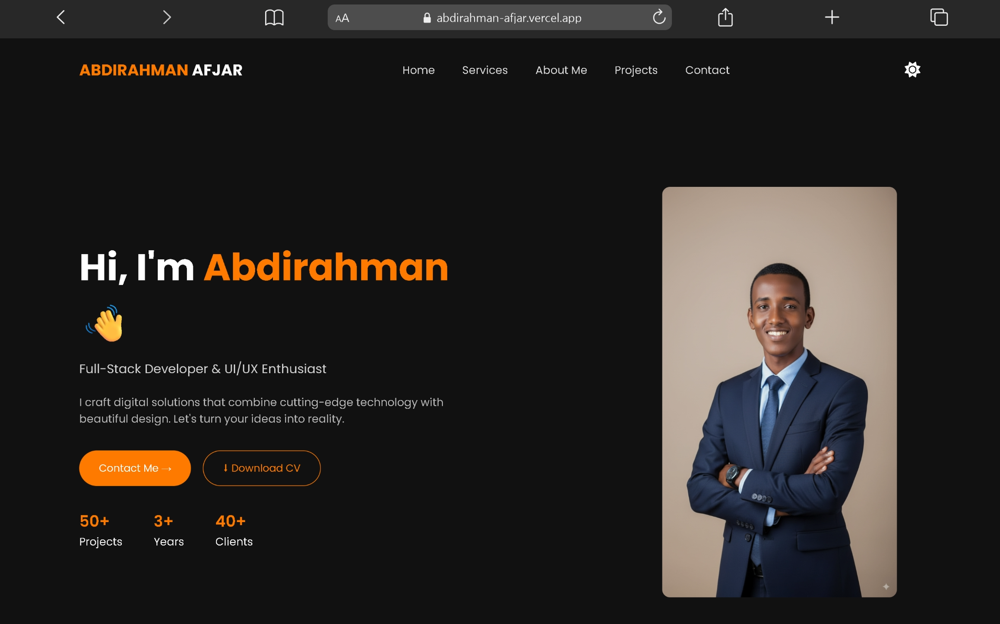

# 🚀 Abdirahman Afjar – Portfolio Website

This is my personal developer portfolio built to showcase my projects, skills, and services.

Live Preview:  
👉 https://abdirahman-afjar.vercel.app

---

## 📌 About The Project

This portfolio website presents:

- My featured projects
- Services I offer
- About me section
- Contact form with WhatsApp integration
- Responsive design for all devices
- Light/Dark theme toggle

The goal of this project is to provide a clean and modern digital presence for clients and recruiters.

---

## 🛠️ Built With

- HTML5
- CSS3
- JavaScript
- Font Awesome

---

## 🎨 Features

- Modern UI design
- Fully responsive layout
- Animated project cards
- Hover effects with live preview buttons
- WhatsApp contact integration
- Theme toggle (Dark / Light mode)

---

## 📂 Project Structure

```plaintext
My-portfolio/
│
├── .vscode/
│
├── src/
│   ├── assets/
│   ├── css/
│   │   └── style.css
│   │
│   ├── js/
│   │   └── main.js
│   │
│   ├── index.html
│   ├── projects.html
│   └── contact.html
│
└── README.md
```

---

## 📸 Screenshots



---

## 📬 Contact

If you’d like to work with me:

- WhatsApp: https://wa.me/+254717474657
- GitHub: https://github.com/abdirahmanafjar
- Email: abdirahmanabdirisack76@gmail.com

---

## 📄 License

This project is open-source and available under the MIT License.
